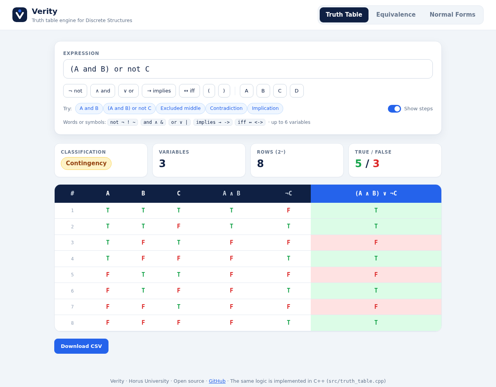
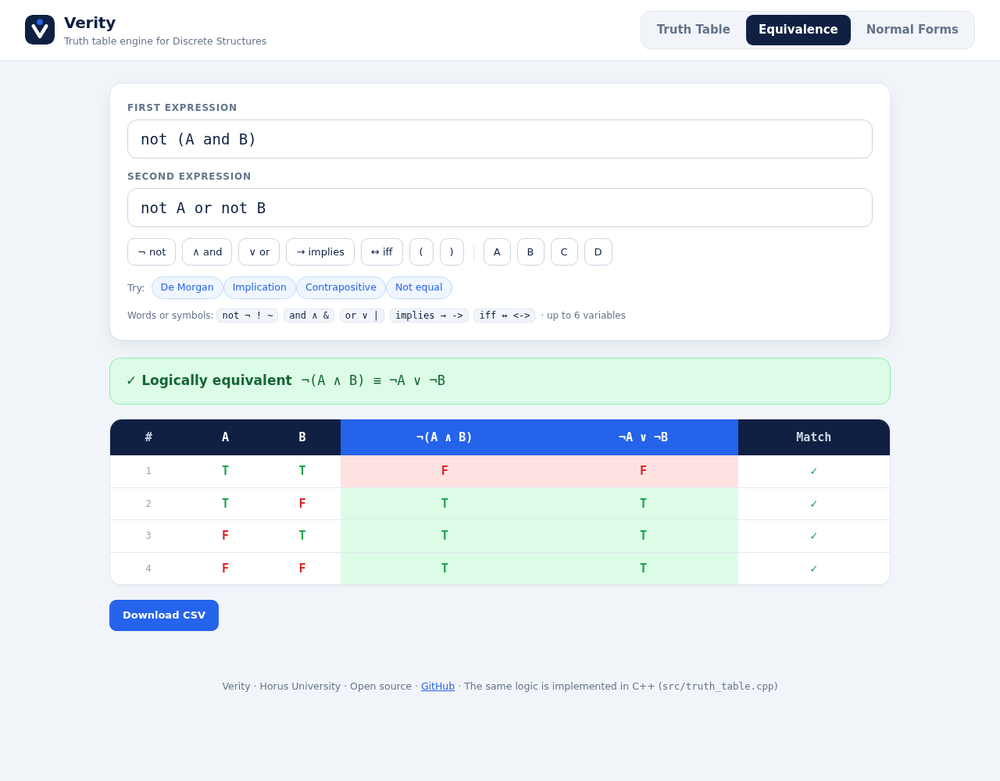
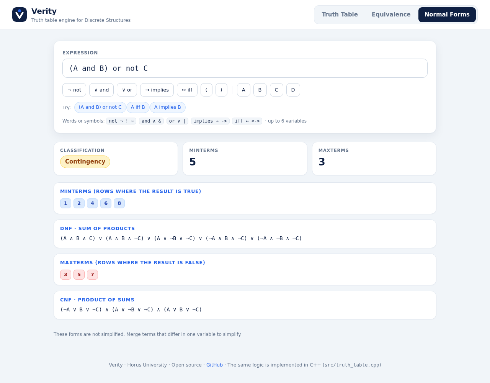

<div align="center">


# Verity

**Truth table engine for Discrete Structures.**
Truth tables, logical equivalence, minterms, DNF and CNF.
A Discrete Structures project, written in C++ with a web demo.

[Live demo](#live-demo) · [Features](#features) · [Run the C++ program](#run-the-c-program) · [How it works](#how-it-works)



</div>

## Features

- **Truth table generator** for any expression with 1 to 6 variables (up to 64 rows).
- **Classification:** tautology, contradiction or contingency.
- **Logical equivalence check** for two expressions. If they differ, it shows the first row where they do.
- **Minterms, maxterms, DNF and CNF** (not simplified, so every step can be followed by hand).
- **Step columns** in the web demo: every sub-expression gets its own column.
- **CSV export** (C++ and web).
- **Opening screen** with the Verity logo and credits (web: plays once per visit, skippable).
- **Operators:** `not`, `and`, `or`, `implies`, `iff`, with parentheses. The web demo also accepts `¬ ∧ ∨ → ↔ ! & | -> <->`.

| Equivalence check | Normal forms |
|---|---|
|  |  |

## Live demo

The web version runs in the browser with no install. It is plain HTML, CSS and JavaScript in [`web/`](web).

- Open `web/index.html` locally, or
- publish it with GitHub Pages: **Settings, Pages, Source: GitHub Actions**. The workflow in `.github/workflows/pages.yml` deploys the `web` folder on every push to `main`.

The footer link already points to https://github.com/kamly760-ctrl/verity_.

## Run the C++ program

Requires a C++11 compiler (g++, clang or MinGW).

```bash
make              # or: g++ -std=c++11 -O2 -o verity src/truth_table.cpp
./verity
```

On Windows with MinGW: `g++ -std=c++11 -O2 -o verity.exe src/truth_table.cpp`.
Use Windows Terminal or the VS Code terminal for the colored splash screen.

```
=== Verity Menu ===
1) Truth table
2) Check equivalence of two expressions
3) Minterms and DNF
4) Export truth table to CSV
0) Exit
```

Example (`A implies B`):

```
A | B | Result
T | T | T
T | F | F
F | T | T
F | F | T
```

`src/truth_table_gui.cpp` is an optional native Windows (Win32) window version with the same logic. Build it with MinGW:
`g++ -std=c++11 -O2 -static -mwindows -o VerityGUI.exe src/truth_table_gui.cpp -lcomdlg32 -lgdi32`.

## How it works

The expression is handled in three steps:

1. **Tokenize.** Put spaces around parentheses and split the text into words.
2. **Parse by precedence.** One function per level, from weakest to strongest: `iff`, `implies`, `or`, `and`, `not`. A stronger operator is evaluated first, like multiplication before addition.
3. **Evaluate for every row.** For `n` variables there are `2^n` rows. The bits of the row number give the True/False value of each variable.

| Operator | Meaning | False only when |
|---|---|---|
| `not A` | negation | A is true |
| `A and B` | conjunction | at least one is false |
| `A or B` | disjunction | both are false |
| `A implies B` | implication, same as `not A or B` | A is true and B is false |
| `A iff B` | biconditional | A and B differ |

Two expressions are **equivalent** when they give the same result in every row. A **minterm** is a row where the result is True; joining the minterms with OR gives the DNF.

## Project structure

```
src/truth_table.cpp      C++ console program (main project)
src/splash.h             animated start screen
src/truth_table_gui.cpp  optional Windows GUI
web/                     browser demo (HTML, CSS, JS)
docs/                    screenshots and logo
```

## Tested

- C++ console program compiled with `g++ -std=c++11 -Wall` with no warnings, and run on Linux with sample expressions (tautology, contradiction, contingency, equivalence, DNF, CSV, invalid input).
- Web logic tested in Node.js against the same cases, and the web pages rendered in headless Chrome.
- The Windows GUI was compiled but has not been run on Windows.

## Author

Yusif Kamel · Horus University, Faculty of Artificial Intelligence · Discrete Structures

Released under the [MIT License](LICENSE).
